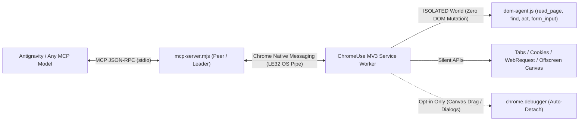

# ChromeUse (`chrome-use`)

> **Why this exists:** Claude and ChatGPT ship dedicated Chrome extensions that let the AI work directly inside your real, logged-in browser session. **Google Antigravity didn't have one** — controlling your live Chrome required toggling `chrome://inspect/#remote-debugging` over and over, clicking *"Allow debugging"* popups every session, and dealing with Chrome's `"started debugging this browser"` banner.
>
> **So I built my own.**

**ChromeUse** is a zero-dependency Chrome Manifest V3 extension + universal Model Context Protocol (MCP) connector. Install the extension once, and **Antigravity** (or Claude Code, Claude Desktop, Cursor, Windsurf, or any MCP-compatible model) can control your live Chrome browser silently, instantly, and with zero remote-debugging prompts.

---

## Key Highlights

- **Zero Remote-Debugging Friction:** Never open `chrome://inspect/#remote-debugging` or click *"Allow debugging"* again.
- **Silent Native Messaging Pipe (`com.chromeuse.bridge`):** Uses Chrome's native OS stdio pipe (`chrome.runtime.connectNative`) instead of polling localhost sockets from the browser — meaning **`0` `ERR_CONNECTION_REFUSED` errors** in `chrome://extensions` even when your IDE is closed.
- **No Debugger Infobar on Everyday Actions:** Uses `chrome.tabs`, `chrome.scripting` (`ISOLATED` world), `chrome.cookies`, passive `chrome.webRequest`, and `captureVisibleTab` by default. Your untouched personal tabs run **zero** injected scripts and trigger zero anti-bot/CSP mutations.
- **Zero `npm` Dependencies (`~25ms` Cold Start):** Runs directly on Node.js 20+ standard library (`node:http`, `node:net`, `node:crypto`, `node:fs`) — no `npx` lag, no `node_modules` bloat.
- **Multi-Client Leader / Peer Relay:** Multiple Antigravity windows, Claude Code, and Cursor can all talk to the same Chrome instance simultaneously without port conflicts.
- **Automatic `"AI Agent"` Tab Grouping & Cleanup:** Tabs opened or operated on by an agent (plus child OAuth/popup tabs) are automatically grouped into a cyan **`AI Agent`** Chrome Tab Group so you never click an agent's tab by mistake — and agents are instructed to close their tabs (`close` / `close_agent_tabs`) as soon as they finish.
- **Human Co-Pilot Awareness (Anti-Double-Submit & Anti-Reopen):** Detects real human (`isTrusted`) form fills, clicks, submits, component updates, and post-submit tab closures on agent tabs (without logging raw passwords/text). If you manually submit a form and the tab closes or advances, the agent gets `[USER_COMPLETED_AND_TAB_CLOSED]` / `[USER_INTERACTION_DETECTED]` instead of mistaking it for a crash, re-opening the tab, or injecting into the wrong input box.
- **One-Click Hardware-Style Kill Switch:** Headless toolbar badge shows green **`ON`** when active; click the toolbar icon once to toggle amber **`OFF`** and instantly sever control.

---

## Architecture



---

## Quick Setup (One Time — 30 Seconds)

### 1. Load the Chrome Extension
1. Open `chrome://extensions` in Chrome and enable **Developer mode** (top-right).
2. Click **Load unpacked** and select the [`extension/`](./extension) folder.

### 2. Register the Native Messaging Bridge
Run the built-in installer (auto-detects your unpacked ChromeUse Extension ID across Windows, macOS, and Linux — no `npm install` needed):

```bash
node mcp-server.mjs --install
```

Then click the **Reload (`⟳`)** icon on **ChromeUse** at `chrome://extensions`. The badge will turn green **`ON`**.

### 3. Add to Antigravity (or Any MCP Client)
Add `chrome-use` to `~/.gemini/config/mcp_config.json` (Antigravity) or your MCP client's config file:

```json
{
  "mcpServers": {
    "chrome-use": {
      "command": "node",
      "args": ["C:\\path\\to\\chromeuse\\mcp-server.mjs"]
    }
  }
}
```

---

## Exposed MCP Tools (13)

| Tool | Read-Only | Purpose |
| :--- | :---: | :--- |
| `tabs` | No | List open tabs (`*` marks active, `[AI Agent]` marks grouped agent tabs), open new tabs, switch focus, `close`, `close_agent_tabs`, reload, go back/forward, or group tabs. |
| `navigate` | No | Navigate active/target/new tab to a URL, wait for load, and immediately return an interactive `[ref_N]` snapshot in one round-trip. |
| `read_page` | Yes | Token-efficient accessibility + DOM outline with stable `[ref_N]` IDs (`interactive`, `full`, or clean `markdown` extraction). Pierces open Shadow DOM & iframes without mutating page DOM attributes. |
| `find` | Yes | Fast semantic, label, placeholder, role, or CSS selector search across the page returning matching `[ref_N]` IDs and coordinates. |
| `act` | No | Click, double/right-click, hover, fill, type, `press_key`, select, check/uncheck, scroll (auto-detects inner SPA scroll panes), or wait. Supports multi-step `steps` batches + `returnSnapshot: true` in a single call. |
| `form_input` | No | Fill an entire multi-field form (React/Vue/Angular inputs, `<select>`, checkboxes, radios, and `contenteditable` editors like Gmail/Slack/Notion) in one shot. |
| `computer` | No | Capture silent viewport/element/region screenshots (`captureVisibleTab` + `OffscreenCanvas`, zero debugger bar), coordinate clicks/drags, or handle native JS `alert`/`confirm`/`prompt` dialogs. |
| `wait_for` | Yes | In-page `MutationObserver` wait for selector, text appearance/disappearance, URL change, or full tab load with zero polling overhead. |
| `evaluate` | No | Run sync or `async/await` JS in `MAIN` or `ISOLATED` world (automatically falls back to ephemeral CDP `Runtime.evaluate` on strict-CSP pages like GitHub). |
| `console_logs` | Yes | Read `console.log`/`info`/`warn`/`error` and uncaught page exceptions on agent-touched tabs. |
| `network_requests` | Yes | Inspect recent HTTP/fetch/XHR requests (`method`, `status`, `type`, `durationMs`, `url`) recorded passively via `chrome.webRequest`. |
| `cookies` | No | List, get, set, or delete cookies (including `HttpOnly` session cookies) for any URL or domain. |
| `upload_file` | No | Attach local files directly to `<input type="file">` silently via `DataTransfer` (or CDP fallback for large files) without opening an OS file picker. |

---

## Security & Privacy Design

1. **Strict Extension CSP (`connect-src 'self'`):** The Chrome extension cannot make external network calls or exfiltrate browser data.
2. **Cross-Site Request & WebSocket Hijacking Protection:** Local peer relay binds strictly to `127.0.0.1`, rejects any HTTP request carrying browser `Origin` or `Sec-Fetch-Site` headers, validates `chrome-extension://` upgrade origins, and requires a user-only `0600` local secret (`~/.chromeuse-bridge.token`).
3. **Zero Idle Footprint:** No static `content_scripts` are injected across `<all_urls>`. Scripts are injected into Chrome's `ISOLATED` world only on tabs you ask the model to read or control.
4. **Instant Pause Toggle:** Clicking the **ChromeUse** toolbar icon sets the badge to **`OFF`**, immediately disconnecting the Native Messaging pipe and rejecting commands until re-enabled.

---

## Verification

Run the built-in self-test suite (verifies Native Messaging LE32 stream framing, >64KB fragmented RFC 6455 WebSocket frames, Origin security guards, Leader/Peer-Relay forwarding, and Gemini/MCP JSON Schema compliance):

```bash
npm test
# or: node mcp-server.mjs --self-test
```

---

## Project Structure

```text
├── extension/
│   ├── manifest.json     # MV3 manifest (ChromeUse, Native Messaging + silent APIs)
│   ├── background.js     # Service worker: Native Messaging router, tabs/cookies/network/CDP fallback
│   ├── dom-agent.js      # On-demand ISOLATED-world snapshot, ref resolver, SPA event & form engine
│   ├── offscreen.html    # Minimal container for screenshot Canvas processing
│   ├── offscreen.js      # On-demand screenshot crop, DPI scaling, and JPEG/PNG/WebP compression
│   └── icons/            # Toolbar & extension icons (16, 48, 128)
├── mcp-server.mjs        # Zero-dependency MCP stdio server + Native Messaging host + installer + self-test
└── package.json          # Scripts: setup, start, test
```
